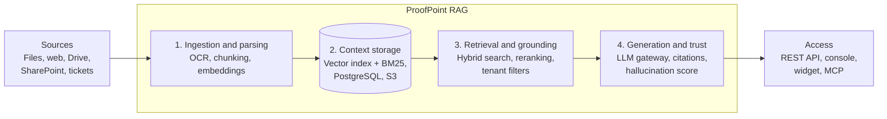

# ProofPoint RAG

**Multi-tenant RAG and AI agent platform: answers grounded in your documents, cited, and scored for reliability.**


ProofPoint RAG turns an organization's documents (PDF, Office files, web pages, Drive, SharePoint…) into a knowledge base you can query through an API, a chat interface, or AI agents. Every answer:

- relies only on the customer's own documents;
- cites its sources, passage by passage;
- comes with a **hallucination score** (0 to 1);
- respects strict isolation between customers (tenants).

The platform can be deployed as **SaaS**, in the customer's **private cloud (VPC)**, or **on-premises**, and natively supports **French, English, and Arabic**.

> Inspired by "RAG-as-a-Service" platforms such as Vectara. ProofPoint RAG is not affiliated with Vectara or with Proofpoint, Inc.

---

## Table of contents

- [Why ProofPoint RAG](#why-proofpoint-rag)
- [Features](#features)
- [Architecture](#architecture)
- [Tech stack](#tech-stack)
- [Quick start](#quick-start)
- [API usage example](#api-usage-example)
- [Repository structure](#repository-structure)
- [Roadmap](#roadmap)
- [Quality targets](#quality-targets)
- [Contributing](#contributing)
- [License](#license)

---

## Why ProofPoint RAG

An LLM on its own does not know a company's internal documents, and it makes things up when it does not know. Building a reliable RAG pipeline yourself means assembling a dozen components: parsing, OCR, chunking, embeddings, a vector database, reranking, an LLM, hallucination detection, access control, observability, and billing.

ProofPoint RAG provides that complete pipeline, ready to use, so teams can focus on their use cases: internal assistants, customer support, document search, compliance, contract analysis.

## Features

### MVP (in progress)

| Area | Features |
| --- | --- |
| Ingestion | Upload PDF, DOCX, PPTX, TXT, MD, HTML; OCR for scanned files; table extraction; configurable chunking |
| Connectors | Web crawler, Google Drive, SharePoint (scheduled and incremental sync) |
| Retrieval | Hybrid vector + BM25 search, metadata filters, multilingual reranking, MMR diversity |
| Generation | Question answering and multi-turn chat, streaming, numbered citations |
| Models | Open models served in-house, or bring your own keys (Claude, GPT, Mistral…) |
| Trust | Hallucination score on every answer, "I don't know" response below a threshold |
| Access | REST API v1 (OpenAPI), scoped API keys, web console, playground, embeddable widget |
| Operations | Multi-tenancy, roles, full per-request traces, dashboard, usage-based billing |

### Planned next (V2 / V3)

- Agents with tools, memory, and an **MCP** server; **A2A** protocol; multi-step deep research
- Access rights inherited from sources, SAML/OIDC SSO, audit log
- Automatic hallucination correction and configurable guardrails
- Multimodal ingestion (images, charts), Python and TypeScript SDKs
- VPC deployment (Helm), then on-premises and air-gapped

## Architecture



A single context layer (2) serves every use case: adding a new assistant or agent does not require re-indexing the data. A shared foundation handles multi-tenancy, authentication, tracing, and usage metering.

## Tech stack

| Component | Choice |
| --- | --- |
| API | Python, FastAPI |
| Background jobs | Celery + Redis |
| Parsing / OCR | Docling, Unstructured, Tesseract |
| Embeddings | BGE-M3 served by Text Embeddings Inference |
| Hybrid index | Qdrant (dense + sparse) |
| Reranker | bge-reranker-v2-m3 |
| LLM | LiteLLM gateway; vLLM for open models |
| Hallucination detection | HHEM-2.1-Open |
| Console and widget | Next.js, React, Web Component |
| Authentication | Keycloak |
| Data | PostgreSQL, MinIO / S3 |
| Observability | OpenTelemetry, Prometheus, Grafana, Langfuse |
| Billing | Lago + Stripe |
| Deployment | Docker, Kubernetes, Helm, Terraform |

## Quick start

> The development environment below is the MVP target; some commands do not work yet.

Requirements: Docker and Docker Compose, 16 GB of RAM, a GPU recommended for embeddings.

```bash
git clone https://github.com/<your-account>/proofpoint_Rag.git
```

```bash
cd proofpoint_Rag && cp .env.example .env
```

```bash
docker compose -f deploy/docker-compose.yml up -d
```

Local services:

| Service | URL |
| --- | --- |
| API and OpenAPI docs | http://localhost:8000/docs |
| Web console | http://localhost:3000 |
| Grafana | http://localhost:3001 |

## API usage example

Create a corpus, upload a file, ask a question:

```bash
curl -X POST http://localhost:8000/v1/corpora -H "x-api-key: $PROOFPOINT_RAG_API_KEY" -H "Content-Type: application/json" -d '{"name": "hr-internal"}'
```

```bash
curl -X POST http://localhost:8000/v1/corpora/hr-internal/upload_file -H "x-api-key: $PROOFPOINT_RAG_API_KEY" -F "file=@employee-handbook.pdf"
```

```bash
curl -X POST http://localhost:8000/v1/query -H "x-api-key: $PROOFPOINT_RAG_API_KEY" -H "Content-Type: application/json" -d '{"corpus": "hr-internal", "query": "How many days of leave after 5 years?", "generation": {"model": "mistral-small", "stream": false}}'
```

Response (excerpt):

```json
{
  "answer": "After 5 years of service, an employee is entitled to 24 working days of leave [1].",
  "citations": [
    { "id": 1, "document": "employee-handbook.pdf", "page": 12, "passage": "…" }
  ],
  "factual_consistency_score": 0.93,
  "trace_id": "tr_8f2c…"
}
```

## Repository structure

```
proofpoint_Rag/
├── api/           # FastAPI: /v1 routes, authentication, quotas
├── workers/       # Celery: ingestion, parsing, OCR, embeddings
├── retrieval/     # Hybrid search, reranking, tenant filters
├── generation/    # LLM gateway, prompts, citations, hallucination score
├── connectors/    # Web crawler, Google Drive, SharePoint
├── console/       # Next.js: admin console and playground
├── widget/        # Chat and search Web Component
├── eval/          # Evaluation suite: recall@10, hallucination rate
├── deploy/        # docker-compose, Helm charts, Terraform
└── docs/          # Specifications, architecture decisions, guides
```

## Roadmap

The MVP is built over 26 weeks in 5 phases, each closed by a validation milestone.

- [ ] **Phase 0 — Discovery (W1–W2)**: prospect interviews, 200-question evaluation set, stack decisions
- [ ] **Phase 1 — Technical foundation (W3–W10)**: infrastructure, accounts, ingestion, multi-tenant hybrid index, search API
- [ ] **Phase 2 — Generation and trust (W11–W18)**: streamed cited answers, chat, hallucination score, console, tracing
- [ ] **Phase 3 — Go-to-market (W19–W22)**: connectors, widget, free trial, billing, public documentation
- [ ] **Phase 4 — Pilots and launch (W23–W26)**: 3 pilot customers, penetration test, load testing, launch

## Quality targets

| Metric | MVP target |
| --- | --- |
| Recall@10 on the evaluation set | ≥ 85% |
| Hallucination rate | < 5% |
| Search latency (p95) | < 300 ms |
| Time to first token (p95) | < 3 s |
| SaaS availability | 99.9% |

The evaluation suite (`eval/`) runs in CI on every release.

## Contributing

Contributions are welcome:

1. Open an issue describing the bug or feature.
2. Create a branch from `main`: `feat/…` or `fix/…`.
3. Add tests; CI must pass (tests, lint, evaluation suite).
4. Open a pull request describing the change.

## License

Distributed under the Apache-2.0 license. See [LICENSE](LICENSE).
